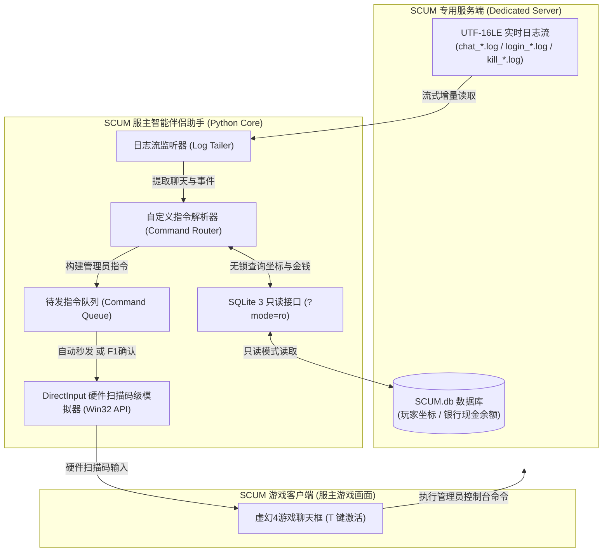

# SCUM Server Companion Assistant (SCUM 服主智能伴侣助手)

<div align="center">


**专为《SCUM》（人渣）独立服务器服主打造的轻量级、非侵入式、高度可自定义的游戏伴侣助手。**  
通过实时监听服务端日志与 SQLite 数据库无锁查询，毫秒级将管理员指令打入游戏，实现玩家自助传送、回城、购车、查编号等丰富功能！

</div>

---

## 🌟 核心特性亮点

- 🛡️ **非侵入式架构，零封号风险**  
  不注入 DLL、不读取修改游戏进程内存、不干涉 EAC (Easy Anti-Cheat) 反作弊，保证服务器与服主账号绝对安全。
- ⚡ **100% 原生 Python 标准库，零第三方依赖**  
  无需执行任何 `pip install`，拉下代码即开即用！
- 🎛️ **全自定义指令系统 (Custom Commands)**  
  所有指令触发词均可在 `assistant_config.json` 中自由配置！支持带感叹号（如 `!p`、`!To`）或直接输入字母/汉字（如 `p`、`tp`、`传`、`查人`、`回家`），完全由服主自行定义。
- 🔢 **玩家数字编号体系 (Player Numbering)**  
  自动为进服玩家分配简短数字编号 `[1]`、`[2]`...，玩家输入 `!To 2` 即可瞬间传送到队友身边，彻底告别在控制台手打长串英文名或特殊符号的烦恼。
- 🏠 **基地记录与快捷回城 (Home / SetHome)**  
  利用无锁只读模式实时读取玩家当前坐标并保存基地标记，玩家可随时输入 `!home` 传送回家。
- 🎁 **新人福利与经济系统联动 (Economy & Perks)**  
  支持新人进服赠送免费传送次数（可配置）。免费次数耗尽后，自动读取 `SCUM.db` 玩家银行现金余额并扣费，余额不足自动拦截。服主享有无限免费特权。
- 🚗 **一键空降全配载具 (Vehicle Delivery)**  
  支持玩家自助购车（摩托、皮卡、水陆两栖飞机等），扣除对应游戏币后在玩家身边坐标精确生成满油、满电、满配件的崭新载具。
- 📦 **物资与装备商城 (Item Shop / !buy)**  
  支持玩家自助购买枪械、弹药、急救包、高级工具箱等，扣除金币后**安静生成在玩家脚边**（默认不进行全服广播，保护玩家隐私且避免聊天刷屏）。
- 📑 **内置全品类物品与载具 ID 手册 ([`item_ids/`](./item_ids/README.md))**  
  项目自带分类整理好的枪械、弹药、护甲、药品、工具、食物、载具等完整蓝图 ID 手册，服主照着模板复制粘贴即可扩充商城！
- 📢 **全服实时公告与击杀通报 (Announcements)**  
  - 新人进服欢迎播报（附带当前在线人数与福利提示）。
  - PvP 击杀与超过 100 米的神射远狙全服通报，内置武器名称本地化美化字典。
- 🎮 **双工作模式与热键切换**  
  - **全自动秒发模式**：当游戏处于激活状态时，检测到指令自动在后台秒发。
  - **F1 手动确认模式**：指令先进入待发队列，服主按 `F1` 键单条放行执行。
  - 按 `F2` 键可在两种模式之间一键平滑切换。

---

## 🏗️ 架构与运行原理



### 为什么它如此稳定？
1. **DirectInput 硬件扫描码 (Hardware Scan Code)**：虚幻引擎 (Unreal Engine) 底层会过滤普通的 Windows 虚拟键。本助手直接模拟硬件键盘扫描码（如 `T` 键扫描码 `0x14`、`Enter` 扫描码 `0x1C`），并加入自动全选退格清空残留字符，彻底解决偶发吞键或乱码问题。
2. **SQLite WAL 无锁只读 URI (`mode=ro`)**：SCUM 服务端运行时会对数据库加排他锁，常规连接方式会导致锁库冲突甚至让服务端崩溃。本助手采用 SQLite 专用的 `mode=ro` 模式，实现并发安全零冲突读取。

---

## 🚀 快速上手

### 1. 环境准备
- 操作系统：Windows 10 / Windows 11 / Windows Server
- Python 版本：Python 3.8 或更高版本（64位）

### 2. 下载与配置
1. 克隆或下载本项目到你的电脑中：
   ```bash
   git clone https://github.com/swkknk1/SCUM-assistant.git
   cd SCUM-assistant
   ```
2. 复制配置模板：
   ```bash
   copy assistant_config.example.json assistant_config.json
   ```
3. 打开 `assistant_config.json`，将 `admin_steam_id` 修改为你自己的 64 位 SteamID。

### 3. 运行助手
双击运行 `3-运行服主助手.bat` 或在终端执行：
```bash
python scum_assistant.py
```
控制台启动后，助手将自动监听日志与在线玩家状态。此时切回游戏正常游玩即可！

---

## ⚙️ 配置文件详细说明 (`assistant_config.json`)

```json
{
    // 服主 64 位 SteamID (用于识别管理员特权，如免扣费等)
    "admin_steam_id": "7656119xxxxxxxxxx",

    // 服务端根目录 (留空时默认读取当前目录下的 ./server，如部署在其他盘请填绝对路径)
    "server_dir": "",

    // 传送与回城扣除的游戏币金额 (默认 4000)
    "teleport_cost": 4000,
    "home_teleport_cost": 4000,

    // 赠送给每个新玩家的免费福利次数
    "free_teleport_count": 1,
    "free_home_count": 1,

    // =========================================================================
    // 【核心】自定义指令与触发词配置
    // 用户可以在 triggers 中添加任意别名，带不带感叹号均可！
    // =========================================================================
    "commands": {
        "help": {
            "enabled": true,
            "triggers": ["!help", "!cmd", "!帮助", "!menu", "!指令", "help", "帮助"],
            "description": "显示常用指令与帮助菜单"
        },
        "player_list": {
            "enabled": true,
            "triggers": ["!p", "p", "!list", "list", "!player", "!players", "!查", "查人", "在线"],
            "description": "查询所有玩家的数字编号与在线列表"
        },
        "teleport": {
            "enabled": true,
            "triggers": ["!to", "to", "!tp", "tp", "!传", "传"],
            "description": "传送到指定编号或名字的队友身旁"
        },
        "set_home": {
            "enabled": true,
            "triggers": ["!sethome", "sethome", "!sh", "sh", "!设家", "设家", "定点"],
            "description": "记录当前站立坐标为基地/家"
        },
        "home": {
            "enabled": true,
            "triggers": ["!home", "home", "!h", "h", "!回家", "回家", "回城"],
            "description": "传送回自己设置的基地坐标"
        },
        "welfare": {
            "enabled": true,
            "triggers": ["!free", "free", "!welfare", "!福利", "福利", "!免费", "免费"],
            "description": "查看自己剩余的免费传送次数"
        },
        "buy_vehicle": {
            "enabled": true,
            "triggers": ["!bc", "bc", "!buycar", "buycar", "!买车", "买车", "提车"],
            "description": "消耗游戏币一键在身边刷出载具"
        },
        "buy_item": {
            "enabled": true,
            "triggers": ["!buy", "buy", "!shop", "shop", "!买", "买", "!购买", "购买", "!物资", "物资"],
            "description": "消耗游戏币一键在身边购买物资/装备 (安静生成不全服通报)"
        }
    },

    // 一键购买载具列表 (可自由增减、改名、修改模型资产与别名)
    "vehicles": {
        "1": {
            "name": "巡航摩托",
            "model": "BPC_Cruiser",
            "cost": 12000,
            "aliases": ["1", "moto", "cruiser", "摩托", "摩托车"]
        },
        "2": {
            "name": "雷杰皮卡",
            "model": "BPC_Rager",
            "cost": 35000,
            "aliases": ["2", "rager", "car", "pickup", "皮卡", "汽车"]
        },
        "3": {
            "name": "水陆两栖飞机",
            "model": "BPC_Kinglet_Mariner",
            "cost": 68000,
            "aliases": ["3", "plane", "mariner", "飞机", "水陆飞机"]
        }
    },

    // 一键购买物资与装备商品库 (可参考 item_ids 目录自由增减任何物品)
    "items": {
        "1": {
            "name": "巴雷特M82重狙",
            "item_id": "Weapon_M82A1",
            "count": 1,
            "cost": 15000,
            "aliases": ["1", "m82", "巴雷特", "大狙"]
        },
        "2": {
            "name": ".50穿甲弹药箱",
            "item_id": "Cal_50_BMG_Ammobox",
            "count": 2,
            "cost": 4000,
            "aliases": ["2", "50bmg", "大狙子弹", "狙击弹"]
        },
        "3": {
            "name": "军用大急救箱",
            "item_id": "Emergency_Bandage_Big",
            "count": 2,
            "cost": 2500,
            "aliases": ["3", "med", "急救包", "绷带"]
        },
        "4": {
            "name": "高级工具箱",
            "item_id": "Tool_Box",
            "count": 1,
            "cost": 5000,
            "aliases": ["4", "toolbox", "工具箱"]
        }
    },

    // 功能开关
    "auto_execute": true,            // 是否开启全自动发送 (true: 激活窗口秒发; false: 需按 F1 确认)
    "welcome_announcement": true,    // 进服欢迎通报
    "kill_announcement": true,       // PvP 击杀与远狙播报
    "announce_npc_kills": false,     // 是否播报丧尸击杀 (默认关闭防止刷屏)
    "announce_item_purchase": false, // 是否全服通报购买商品成功 (默认 false 关闭，安静生成在脚边不刷屏)
    "sound_alert": false             // 指令入队是否有蜂鸣提示音
}
```

### 💡 常见自定义示例

- **我想把查玩家编号改成只用一个字母 `p`：**  
  在 `commands.player_list.triggers` 中保留 `["p", "!p"]` 即可，玩家在游戏聊天打 `p` 就会立即触发查询！
- **我想让玩家输入 `传 2` 就能传送：**  
  在 `commands.teleport.triggers` 中添加 `"传"`，玩家输入 `传 2` 即可直接传送到编号为 2 的队友身边！
- **我想在商城添加新物品（如夜视仪、AK47、食物）：**  
  直接查看项目内的 **[`item_ids/`](./item_ids/README.md)** 手册，照着 `items` 的格式复制粘贴即可，零代码修改！
- **我不希望玩家可以使用买车功能：**  
  直接将 `commands.buy_vehicle.enabled` 设置为 `false` 即可一键禁用。

---

## 🛠️ 开发者二次开发指南 (如何添加新指令)

代码内部采用高度模块化设计，清晰划分了 **8 大功能模块**。如果你想为服务器添加新功能（例如自杀重生 `!suicide` 或新手礼包 `!kit`），只需 3 步：

### 第一步：在 `assistant_config.json` 注册指令触发词
```json
"commands": {
    "suicide": {
        "enabled": true,
        "triggers": ["!suicide", "!自杀", "自杀"],
        "description": "立即自杀并重新跳伞"
    }
}
```

### 第二步：在 `scum_assistant.py` 的 `handle_chat()` 中添加逻辑
```python
# 匹配自杀指令 (无参数)
matched_suicide, _, _ = self.match_cmd("suicide", msg, has_arg=False)
if matched_suicide:
    # 压入控制台执行队列
    self.queue_command(f"#Kill {name}", f"玩家 {name} 请求自杀")
    return
```

### 第三步：运行测试
启动助手，在游戏聊天框中输入 `自杀` 或 `!suicide`，助手会自动识别并发起 `#Kill <玩家名>`，立刻生效！

---

## ❓ 常见问题排查 (FAQ)

### Q1: 助手无法发送指令，提示未聚焦？
> **解答**：为了防止在服主打字或使用其他软件时误触发按键，助手内置了窗口安全校验。只有当屏幕当前前台窗口为 **SCUM 游戏客户端** 时才会模拟输入。如果你在后台测试，可以先切到游戏画面，或者直接按下键盘上的 **`F1` 键** 手动强行发送。

### Q2: 出现玩家坐标获取中 / 查不到家坐标？
> **解答**：SCUM 服务端将玩家三维位置记录在 `SCUM.db` 中。如果玩家刚进入游戏尚未移动，数据库可能暂未产生位置快照。让玩家在原地正常跑动 2~3 秒后再输入 `!sethome` 即可成功抓取！

### Q3: 服务端不在助手同级目录下怎么配置？
> **解答**：打开 `assistant_config.json`，在 `"server_dir"` 中填写你的实际服务端根目录（例如 `"D:\\SCUM_Dedicated_Server"`），助手将自动定位到其下的 `Saved/SaveFiles/Logs` 与 `SCUM.db`。

---

## 📄 开源与使用许可协议 (License)

本项目遵循 **[CC BY-NC-SA 4.0 (知识共享 署名-非商业性使用-相同方式共享 4.0 国际许可协议)](LICENSE)**：

- ✅ **允许免费使用**：欢迎所有玩家、服主免费部署、使用与分享。
- ✅ **允许自由修改 (二次开发)**：您可以在此代码基础上添加任意您需要的自定义功能。
- ❌ **严禁商业化营利 (Non-Commercial)**：**任何人不得将本项目源码、编译物或其修改版本用于任何商业营利目的**（包括但不限于：倒卖源码、打包成收费辅助/伴侣出售、在商业服中将其作为收费增值服务等）。
- 🔄 **相同方式共享 (Share-Alike)**：若您在本项目基础上进行了修改或二次开发并公开发布，您的派生版本**必须以相同的许可协议 (CC BY-NC-SA 4.0) 保持免费开源**，不得转为闭源或付费。

